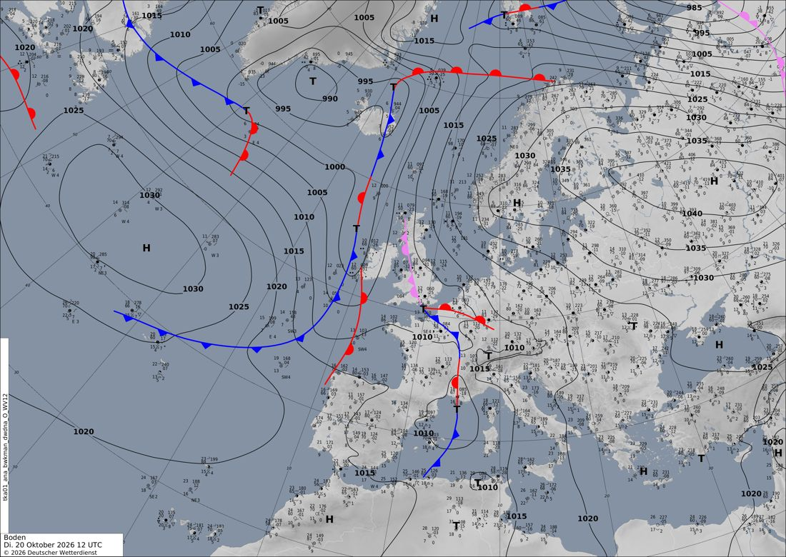
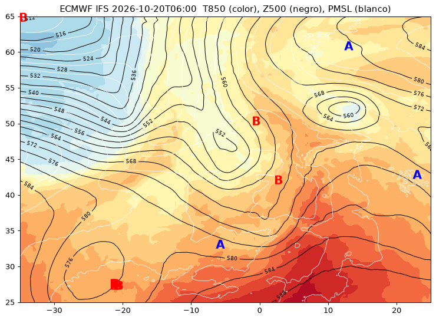
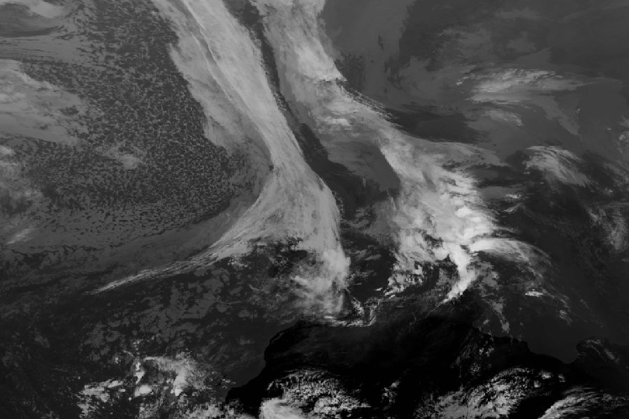

# Aula Meteo · Fase 0: exploración de fuentes

*20 de octubre de 2026. Nombre provisional del proyecto.*

**Objetivo:** una web local que cada día descarga datos meteorológicos reales, dibuja mapas interactivos
de nivel «meteorólogo» y genera con IA una explicación didáctica del tiempo del día, con enlaces a fichas
de conceptos clave.

**Decisiones tomadas:** explicación generada con IA · ejecución diaria en local (sin GitHub Actions por
ahora) · mapa interactivo · proyecto independiente, fuera de Terra Aperta · **ámbito europeo**
(no solo España).

## 1. Fuentes comprobadas

| Fuente | Qué da | Acceso | Licencia | Estado |
|---|---|---|---|---|
| **ECMWF Open Data** (IFS 0,25°) | Modelo completo: presión al nivel del mar, geopotencial y temperatura por niveles, viento, precipitación, agua precipitable, CAPE | Sin clave, `ecmwf-opendata` | CC BY 4.0 | ✅ Probado |
| **EUMETSAT View** (WMS) | Meteosat de tercera generación (MTG): infrarrojo, visible, RGB (*geocolour*, *airmass*, polvo, niebla…), cada 10 minutos | Sin clave, CORS abierto | Libre con atribución | ✅ Probado |
| **DWD Open Data** (servicio alemán) | **Análisis de superficie con frentes trazados por predictores**, Europa y Atlántico Norte, cada 6 h, con observaciones de estaciones | Sin clave, PNG en opendata.dwd.de | Abierta con atribución (por confirmar en fase 1) | ✅ Probado |
| **AEMET OpenData** | Detalle de España: radar, observaciones, avisos. Opcional | **Clave gratuita** (alta por correo) | Reutilización con atribución | ⏳ Opcional |
| **Claude Code (`claude -p`)** | Redacción de la explicación diaria | Suscripción del usuario | — | ✅ Probado |

### ECMWF: lo que se ha medido

- Ejecución más reciente disponible a las 16:40 (hora peninsular): la de 06 UTC. Para el uso diario
  conviene la de **00 UTC**, que llega con alcance completo a 10 días.
- Las pasadas de 06 y 18 UTC solo llegan a 90 h.
- Tamaño de 3 pasos (0, 24 y 48 h) del globo entero:
  - superficie, 7 variables: **9 MB en 15 s**;
  - niveles de presión (850/500/250 hPa × 4 variables): **17 MB en 20 s**.
- La prueba se recortó a 25–65° N, 35° O–25° E (malla de 161×241 puntos). **Para Europa entera se
  ampliará a 25–75° N, 45° O–50° E** (unos 201×381 puntos): de Islandia a Moscú y de Canarias al Cabo
  Norte. Las capas pesarán aproximadamente el doble, todavía ligeras.
- Capas para el mapa interactivo:
  - isobaras como líneas GeoJSON: **69 KB**;
  - temperatura en 850 hPa como imagen de color superpuesta: **28 KB**.

  Es muy ligero y no necesita servidor de teselas.

### Análisis del DWD: los frentes resueltos para toda Europa

El servicio alemán publica en abierto el mapa de análisis que dibujan sus predictores. Este es el de
hoy a las 12 UTC:



- **Lo que aporta:**
  - frentes frío, cálido y ocluido sobre Francia y el canal de la Mancha;
  - un frente frío que cruza Baleares;
  - el anticiclón ruso de 1040 hPa;
  - los modelos de estación con observaciones reales.

  Así no hay que detectar frentes automáticamente.
- **Un detalle de lectura:** las letras están en alemán, **T** (*Tief*, baja) y **H** (*Hoch*, alta).
  Es buen material para una ficha.
- **Limitación:** es una imagen en proyección estereográfica polar, así que no se superpone al mapa
  interactivo. Irá en un panel propio, «la carta oficial», junto al mapa del modelo. La IA recibirá
  las dos imágenes y explicará la relación entre ellas.

### Detección automática de sistemas: prototipo

Se han buscado máximos y mínimos locales en presión y en 500 hPa. Esto es lo que aparece hoy:



- **Vaguada / embolsamiento frío en 500 hPa sobre el golfo de Vizcaya** (551 dam, cerrado). En
  superficie corresponden una baja en el canal de la Mancha (1008 hPa) y otra junto a Cataluña (1009 hPa).
- **Baja aislada en altura sobre Alemania** (557 dam), bajo un anticiclón escandinavo de 1036 hPa: un
  *bloqueo* de libro.
- Baja débil en altura al oeste de Canarias (574 dam).

El satélite de esa misma hora confirma la estructura: la banda nubosa en forma de coma acompaña a la vaguada.



**Pendiente de pulir:**

- Quitar duplicados en zonas planas; hoy salen varios puntos para la misma baja.
- Exigir profundidad mínima o que el contorno esté cerrado.
- Distinguir una DANA (mínimo cerrado y aislado del chorro) de una vaguada abierta.
- Frentes: resuelto con el análisis del DWD. No hace falta detectarlos.

## 2. Arquitectura propuesta

```
tarea diaria de Windows (07:30)
  └─ python -m aulameteo.daily
       ├─ fetch:   ECMWF 00 UTC (pasos 0–72 h) + análisis DWD 00 UTC [+ AEMET opcional]
       ├─ fields:  recorte, derivados (espesor 500–1000, advección, cizalladura, chorro)
       ├─ detect:  borrascas, anticiclones, vaguadas, DANAs, chorro, inestabilidad → JSON
       ├─ layers:  GeoJSON (isolíneas, sistemas) + PNG de color reproyectado a Mercator
       ├─ explain: Claude recibe el JSON de sistemas + imágenes del mapa → texto con [[concepto]]
       └─ site/:   HTML estático (MapLibre GL) + fichas de conceptos → abrir en el navegador
```

- **Mapa interactivo (MapLibre GL).** Capas que se pueden activar o desactivar: presión, 500 hPa,
  T850, chorro, CAPE, precipitación, satélite en directo (WMS de EUMETSAT) y radar. Un deslizador
  temporal recorre 0–72 h. Los sistemas detectados aparecen marcados en el mapa y llevan a su ficha.
  - **Reproyección:** los campos de color se calculan en latitud/longitud y hay que pasarlos a
    Mercator antes de superponerlos. Si no, a 70° N quedarían desplazados cientos de kilómetros.
  - **Texto en dos niveles:** primero la situación en Europa, después el zoom en una zona
    configurable (por defecto, la península).
- **Explicación con IA.** El modelo recibe los **datos detectados** (no tiene que inventarlos) y además
  la imagen del mapa. Se le pide que explique solo lo que hay en esos datos y que enlace a las fichas
  con una sintaxis fija (`[[dana]]`), que el código convierte en enlaces.
- **Fichas de conceptos.** Markdown escrito y revisado una vez, no generado cada día. Cada ficha guarda
  un histórico de «días en que apareció este concepto», con enlace al mapa de ese día.
- **IA con la suscripción, no con la API.** El paso `explain` llama a Claude Code en modo no
  interactivo (`claude -p … --output-format json`), que usa la sesión iniciada con tu suscripción.
  No hace falta clave de API ni se paga aparte: el consumo cuenta contra los límites del plan.
  Se ha probado el 20/10/2026 leyendo el mapa: 19 s, `claude-opus-5-5`, texto correcto con marcas
  `[[concepto]]`.
  - **Hay que aislarlo de tu configuración.** En la prueba heredó el estilo de salida
    «Explanatory» y las instrucciones de `CLAUDE.md`.
  - En la fase 1 se lanzará con `--system-prompt-file` propio, solo con la herramienta `Read` y
    desde un directorio de trabajo neutro.

## 3. Lo que necesito del usuario

1. *(Opcional)* **Clave de AEMET OpenData**, solo para el detalle de España (radar y avisos):
   <https://opendata.aemet.es/centrodedescargas/altaUsuario>. Guárdala en `AEMET_API_KEY`.
2. **OK para la fase 1:** descarga diaria, detección, mapa interactivo con 3–4 capas, primeras 10 fichas
   y explicación con IA.

## 4. Primeras fichas propuestas

Isobara y gradiente de presión · borrasca y anticiclón · frentes (frío, cálido, ocluido) ·
geopotencial y mapa de 500 hPa · vaguada y dorsal · DANA (baja aislada en niveles altos) ·
corriente en chorro · temperatura en 850 hPa y masas de aire · inestabilidad y CAPE · bloqueo
atmosférico · cómo leer el satélite (IR, visible, RGB).
